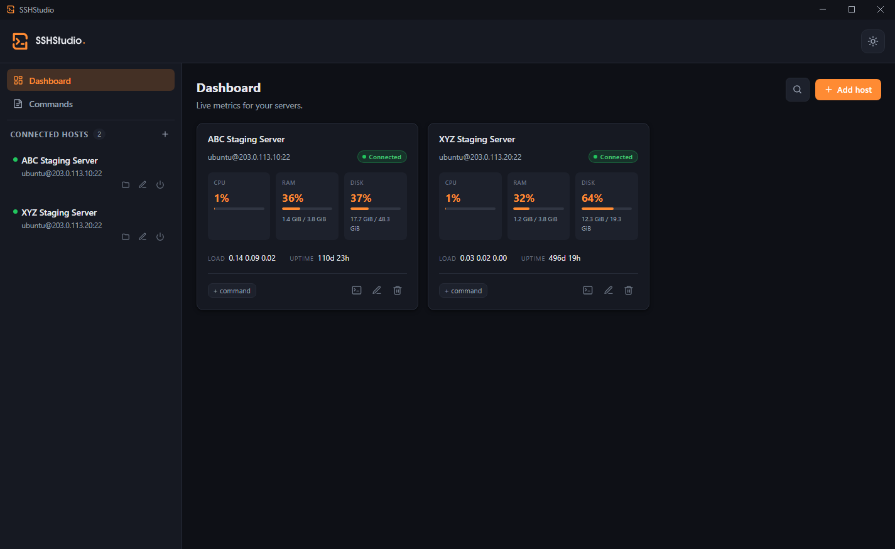
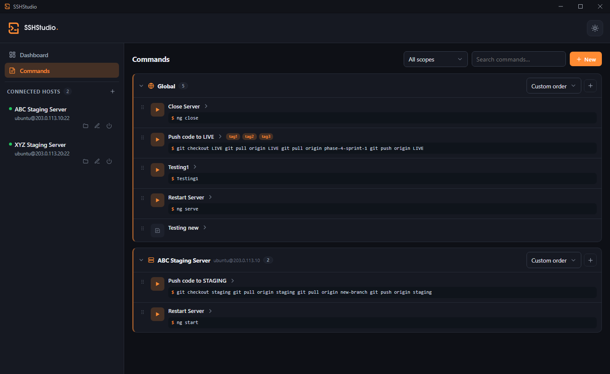

<div align="center">


# SSHStudio

**A fast, lightweight SSH & SFTP manager for Windows, macOS and Linux.**
Hosts, live server dashboards, real terminals and saved commands — in one clean desktop app. No accounts, no telemetry.

[](https://github.com/devstudio-us/ssh-studio/releases/latest)
[](https://github.com/devstudio-us/ssh-studio/releases)
[](LICENSE)

[](https://github.com/devstudio-us/ssh-studio/stargazers)

[**Download**](#download--install) · [Features](#features) · [Build from source](#build-from-source) · [How it works](#how-it-works) · [Contributing](CONTRIBUTING.md)

</div>

<br />

<p align="center">
  
</p>

---

## Download & install

Grab the file for your OS from the **[Releases page](https://github.com/devstudio-us/ssh-studio/releases/latest)**, then follow the steps for that OS. No sign-up, nothing to configure first.

| Platform | File to download |
|----------|------------------|
| **Windows** | `SSHStudio_x.y.z_x64-setup.exe` (or `.msi`) |
| **macOS** — Apple Silicon (M1/M2/M3) | `SSHStudio_x.y.z_aarch64.dmg` |
| **macOS** — Intel | `SSHStudio_x.y.z_x64.dmg` |
| **Linux** | `SSHStudio_x.y.z_amd64.AppImage` or `.deb` |

<details open>
<summary><b>🪟 Windows</b></summary>

1. Download and run the **`.exe`** installer.
2. The app isn't code-signed yet, so Windows SmartScreen may warn you — click **More info → Run anyway**.
</details>

<details>
<summary><b>🍎 macOS</b></summary>

1. Download the **`.dmg`** — **aarch64** for Apple Silicon (M1/M2/M3), **x64** for Intel.
2. Open it and drag **SSHStudio** into **Applications**.
3. On first launch macOS may say it "can't be opened" (it isn't notarized yet). Either **right-click the app → Open → Open**, or run this once in Terminal:
   ```bash
   xattr -cr /Applications/SSHStudio.app
   ```
   *(A signed, notarized build is planned.)*
</details>

<details>
<summary><b>🐧 Linux</b></summary>

**Debian / Ubuntu (`.deb`):**
```bash
sudo apt install ./SSHStudio_*_amd64.deb
```
**Fedora / RHEL (`.rpm`):**
```bash
sudo dnf install ./SSHStudio-*.x86_64.rpm
```
**AppImage (any distro):**
```bash
chmod +x SSHStudio_*_amd64.AppImage
./SSHStudio_*_amd64.AppImage
```
</details>

---

## Features

### 📊 Dashboard

Every host on one screen. Connect one and its card goes live with **CPU, memory, disk, load average and uptime**, refreshing every few seconds. A host that can't be reached shows the error inline so you know exactly what's wrong.

<p align="center"></p>

### ⌨️ Commands

Save reusable commands and snippets, **grouped by scope** — a Global section plus one per server. Each section sorts on its own, rows **drag to reorder**, expand to show the full command and a description, and **run straight into a terminal**.

<p align="center"></p>

### …and the small things

- **Multi-tab terminals** — real interactive shells (xterm.js), with several independent tabs per server and your saved commands one click away.
- **Two-pane SFTP** — browse your computer and the server side by side; upload and download files or whole folders, with overwrite prompts and live progress.
- **Key or password auth** — pick per host; passwords are saved in your **OS keychain**, never in a config file.
- **Light & dark themes**, matching your system by default.
- **Strict host-key checking** — trust on first connect, refuse on a changed key.
- **Nothing phones home** — no accounts, no analytics, no telemetry.

---

## Build from source

### 1. Install the prerequisites

This is the **only** OS-specific part. On every platform you need:

| Tool | Version |
|------|---------|
| [Node.js](https://nodejs.org) | **≥ 22.22.3** (or 24.x) |
| [Rust](https://rustup.rs) | latest stable |

Then the native build tools for **your** OS:

- **🪟 Windows** — [Microsoft C++ Build Tools](https://visualstudio.microsoft.com/visual-cpp-build-tools/) (WebView2 already ships with Windows 10/11).
- **🍎 macOS** — `xcode-select --install`
- **🐧 Linux (Debian/Ubuntu)** —
  ```bash
  sudo apt install -y libwebkit2gtk-4.1-dev librsvg2-dev patchelf \
    build-essential curl wget file libxdo-dev libssl-dev \
    libayatana-appindicator3-dev
  ```

### 2. Clone, install and run

These commands are **the same on Windows, macOS and Linux**:

```bash
git clone https://github.com/devstudio-us/ssh-studio.git
cd ssh-studio
npm install
npm run tauri dev       # run the app in development
npm run tauri build     # build an installer for your current OS
```

> The first `npm run tauri dev` is slow — Cargo compiles the Rust crates from scratch (a few minutes). After that it's fast.

---

## How it works

SSHStudio is a single **Angular** app talking to a thin **Rust** backend over **Tauri 2**'s IPC. The Rust layer only does the heavy lifting — networking, filesystem, PTY and keychain — while all the product logic lives in Angular.

- **SSH / SFTP:** the `russh` + `russh-sftp` crates.
- **Secrets:** saved passwords go to the OS keychain via the `keyring` crate.
- **Config:** hosts and commands are plain TOML (`hosts.toml`, `notes.toml`) in your OS config directory; host fingerprints live in `known_hosts.toml`. **Secrets are never written to these files.**

---

## Troubleshooting

- **macOS "can't be opened" / "damaged":** see the [macOS note](#download--install) above — the build isn't signed yet; right-click → Open, or `xattr -cr`.
- **A host hangs on connect:** unreachable hosts now time out in ~20s with a clear error. Check the address, port and that SSH is running.
- **UI-only dev in a browser (`npm start`) shows errors:** that mode has no Rust backend, so SSH/SFTP calls fail — use `npm run tauri dev` for the real app.

---

## Contributing

Contributions are welcome — see **[CONTRIBUTING.md](CONTRIBUTING.md)** for how to set up, what to run before a PR, and the project layout.

## License

[MIT](LICENSE) © devstudio-us

<div align="center">

If SSHStudio is useful to you, a ⭐ on the repo is appreciated.

[Report a bug](https://github.com/devstudio-us/ssh-studio/issues) · [Request a feature](https://github.com/devstudio-us/ssh-studio/issues)

</div>
